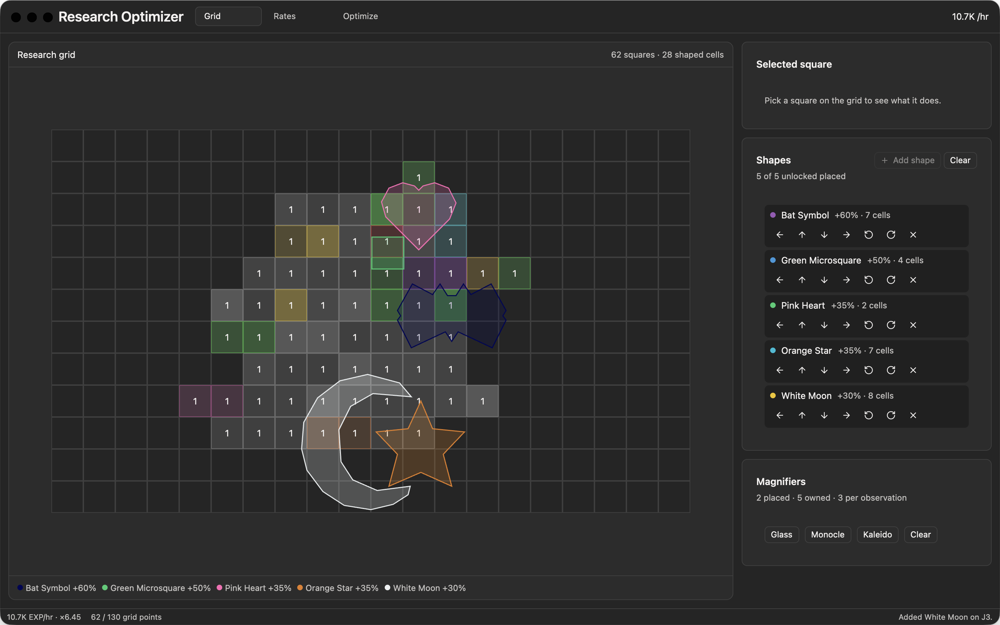
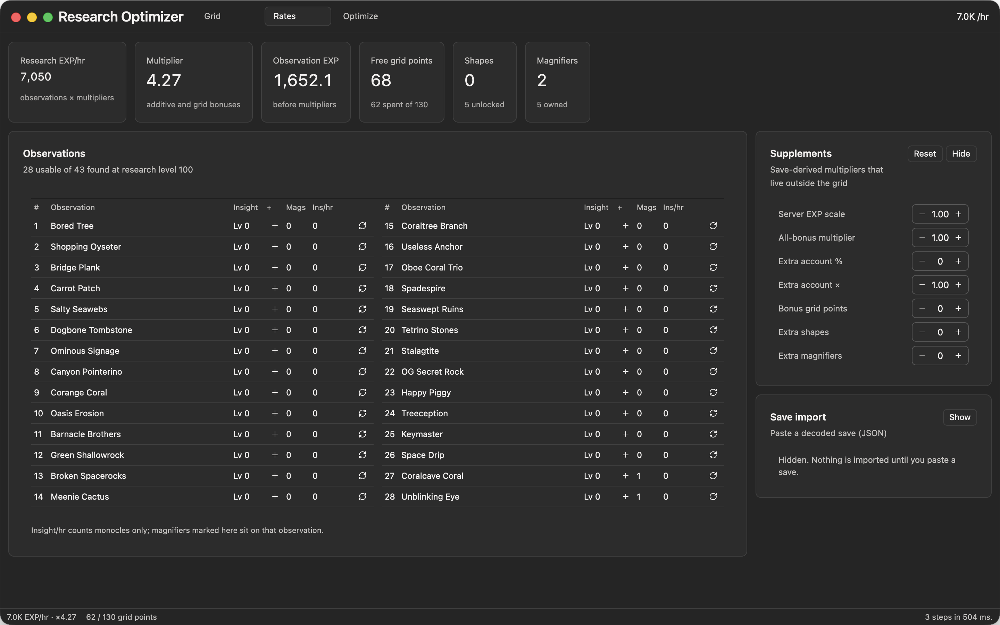
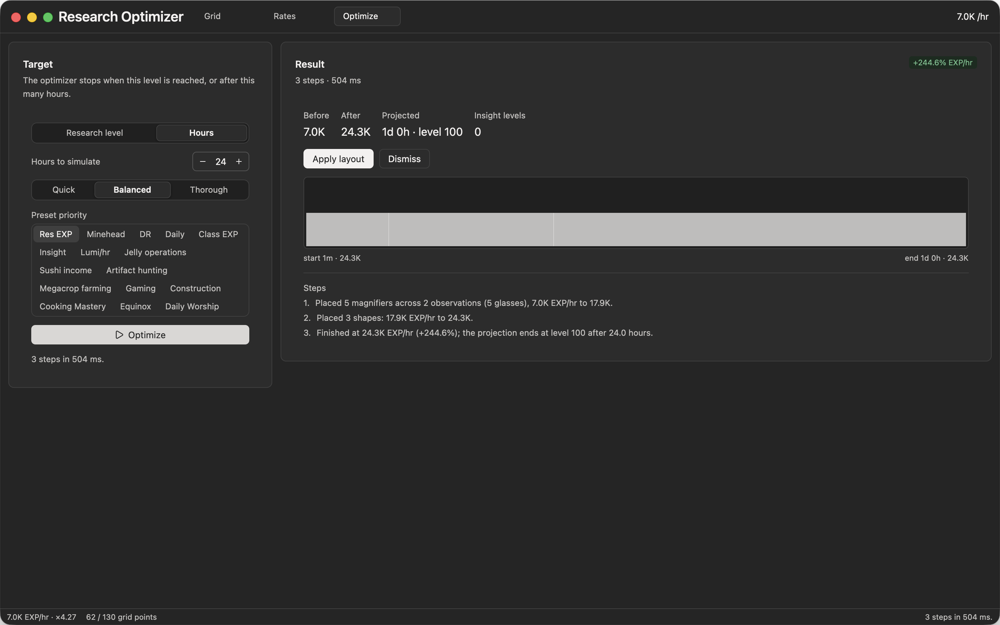
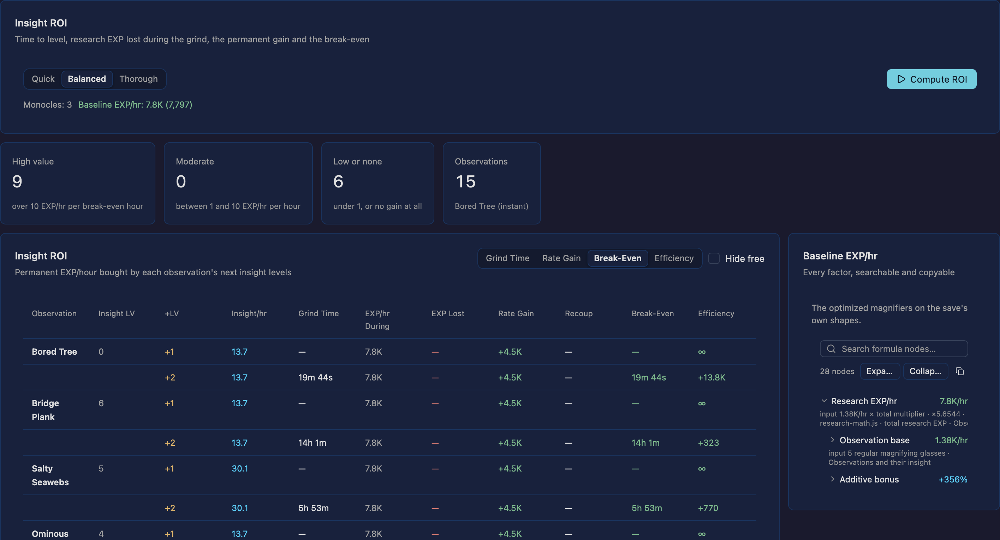

# Idleon Optimizer

**Every Legends of Idleon calculator in one fast, offline desktop app.**

Load your save once and get answers for research, sailing, farming, sneaking, spelunking and
two dozen other systems, all computed locally in Rust. Searches that would be too slow
anywhere else, like placing every research shape or spending a whole grid-point budget, finish
in moments.



| Rates | Optimize | Insight ROI |
| --- | --- | --- |
|  |  |  |

## Highlights

- **One save, every calculator.** Import your account once; each section reads what it needs and
  says plainly when the save lacks something, instead of guessing.
- **Real optimizers.** Research shape placement, magnifier assignment and grid-point spending run
  as parallel searches, not rules of thumb.
- **Every number explained.** Results open into a searchable formula tree showing each input,
  multiplier and source.
- **Picks up where you left off.** Your save, settings and open section come back on the next
  launch. Export the whole window as one project file to share or restore it.
- **Private by design.** No account, no server, no network. Your save never leaves your machine.

## What's inside

| Group | Calculators |
| --- | --- |
| General | Combat Simulator · All Stats · Statue Calculator |
| World 2 | Fishing · Prisma · Killroy |
| World 3 | Cog Board · Worship Tower Defense |
| World 4 | Ladle · Cooking Mastery |
| World 5 | Fountain · Jar · Sailing · Cglunko · Coral God Rank · Monument · Opal |
| World 6 | Sneaking · Farming |
| World 7 | Research · Clamworks · Royal Guardian · Spelunking · Jelly Operator |
| Tools | Damage Breakdown · Drop Rate · Coin Multiplier · BoneJoePickle |

Most are complete; a few are partial and name what they still need. See the
[roadmap](docs/roadmap.md) for the status of each.

## Get started

1. **Download** the build for your platform from
   [Releases](https://github.com/mastro993/idleon-optimizer/releases). Stable releases and a
   nightly beta of `main` are published for macOS, Windows and Linux. The builds are unsigned, so
   the first launch needs one extra click; [`docs/release.md`](docs/release.md) shows it for each
   platform.
2. **Import your save.** Click **Import** in the header, then drop, browse for or paste your
   account's save JSON. You get a preview of what was found before anything is applied.
3. **Pick a calculator** from the dashboard. Type to filter the cards; <kbd>Esc</kbd> takes you
   back.

## Build from source

You need Rust (`rust-toolchain.toml` pins the version) and a C toolchain (Xcode Command Line
Tools on macOS).

```console
git clone --recurse-submodules https://github.com/mastro993/idleon-optimizer
cd idleon-optimizer
cargo run --release
```

The first build compiles GPUI and takes a few minutes. Already cloned without submodules? Run
`git submodule update --init --recursive` first.

Handy flags: `--section <id>` opens a calculator directly and `--list-sections` prints them all.
`--no-default-features` builds without the UI automation bridge.

## Contributing

```console
cargo test
cargo clippy --workspace --all-targets -- -D warnings
cargo fmt --all -- --check
```

Each calculator is its own crate under `crates/`, with its game tables in `data/*.json`; the
window lives in `crates/app`. [`AGENTS.md`](AGENTS.md) covers the crate layering, test data and
UI harnesses, and [`docs/plan.md`](docs/plan.md) the architecture. Work is tracked in
[issues](https://github.com/mastro993/idleon-optimizer/issues), one milestone per calculator.

Built with [GPUI](https://github.com/zed-industries/zed/tree/main/crates/gpui) and
[GPUI Kit](https://gpui-kit.com).

## Credits

- [Legends of Idleon](https://www.legendsofidleon.com) is a free idle MMO by LavaFlame2. Join
  the community on [Discord](https://discord.gg/idleon).
- This project comes from the original idea of
  [Corgan/idleon-research-optimizer](https://github.com/Corgan/idleon-research-optimizer)
  ([website](https://corgan.github.io/idleon-research-optimizer/)).
