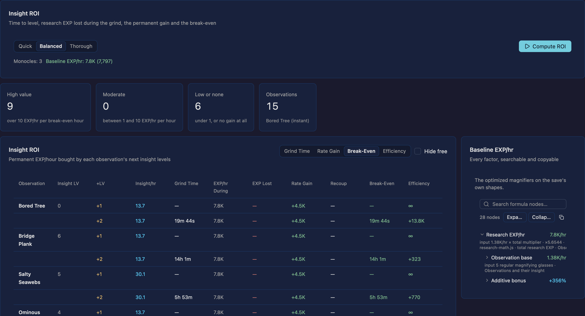
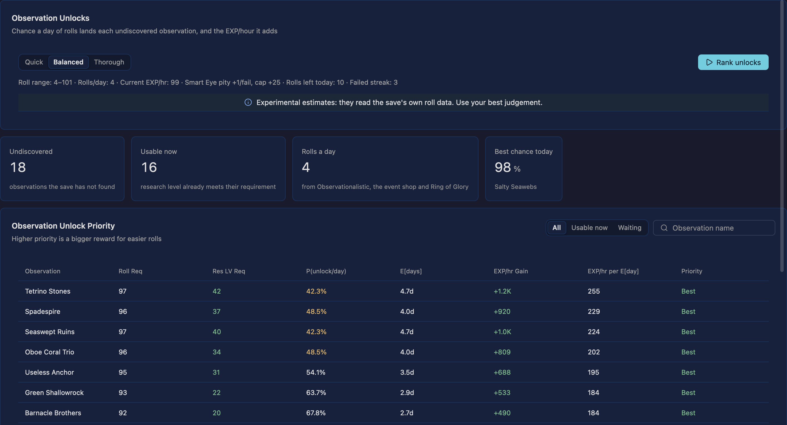

# Idleon Optimizer

A native desktop rebuild of
[Corgan/idleon-research-optimizer](https://github.com/Corgan/idleon-research-optimizer) in Rust with
[GPUI](https://github.com/zed-industries/zed/tree/main/crates/gpui) and
[Ely](https://elygpui.com) components. The upstream runs its simulations in browser workers; this app
runs them in a local Rust core, so a shape, magnifier and grid-point pass costs milliseconds and can
afford a real search instead of a heuristic.

The current build opens on the dashboard and implements the research section, the Killroy weekly
forecast, the statue table, the farming field, the Clamworks overview, upgrades, AFK claim,
optimizer and promotion tracker, the shadow-ban and endgame checks, the hidden BoneJoePickle
calculator and the Bravery, Justice and Wisdom tabs of the Monument calculator. The plan covers the
full upstream suite: a dashboard that opens every calculator, with one milestone per section and
one issue per feature ([`docs/roadmap.md`](docs/roadmap.md)).


| Rates | Optimize | Insight ROI |
| --- | --- | --- |
|  |  |  |



## What it does

- **The dashboard** — the 25 upstream calculators as a card grid grouped General through World 7,
  each with its icon, world badge and description. Search filters by title, description or world,
  Escape clears it, and every card has a stable `card-<section>` id that opens its section.
- **One section registry** — `src/sections/` declares every upstream page once: id, title, group,
  icon, description, spec link, status, dashboard card and the module that renders it. The shell
  routes to that module, keeps each section's own state alive across dashboard visits, and offers to
  resume the last section. Escape or Cmd/Ctrl+Left leaves any section; planned sections and unknown
  ids land on a named empty state instead of a panic. The five hidden upstream tools (All Stats,
  Damage, Drop Rate, Coin Multiplier, BoneJoePickle) are registered without cards and open with
  `--section <id>`.
- **One shell for every section** — the shared page header (back, title, world badge, save status,
  export, import), Ely tab strip, cards, tables and form controls, with the upstream dark palette.
  Below 1360 px the side rails stack and tables scroll, so the 1080×680 minimum window stays
  usable.
- **The last session comes back** — the active section, the decoded save, the research state and
  every section config are written to one app-data session file after a short debounce, then
  restored on the next launch. The import dialog lists the recent imports with their format and
  local time. A file that cannot be read is renamed to `session.json.corrupt-<timestamp>` and the
  app starts on a clean dashboard; `--state-dir` or `IDLEON_OPTIMIZER_STATE_DIR` moves the file for
  tests and separate profiles.
- **The farming field** — the 9×4 plots from `farmPlotData` with their seed-family colours, crop id,
  overgrowth, plot rank, evolution chance and growth time. Clicking a plot opens its saved row: crop
  and evolution depth, growth progress and remaining time, the next evolution and overgrowth rolls,
  expected harvest, Rank XP and Farming EXP per harvest. The selected plot and the target crop
  persist across dashboard visits.
- **Consistent states** — every section shows the shared no-save banner with its import action, the
  header names a partial import, and every long job goes through one shared task runner: it runs off
  the UI thread, reports progress, cancels without losing the previous result, and marks a result
  stale when its inputs change.
- **The statue calculator** — all 32 statues for the selected character with their saved level, EXP
  progress and the full bar the next level needs, an availability badge for rows the save leaves
  out, search by name or effect, and game-order, level or remaining-EXP sort. It reads
  `StatueLevels_<n>` and `charNames`; requirements are the upstream EXP formula, including the
  statue-1/2/3 rounding gates above level 300. The STARTUE EXP bubble's retention, the Skinny 0 Cal
  vial, the Onyx/Zenith tier multiplier and each statue's Royal Guardian Flair drive a per-row target
  and the statues that target needs, under a guaranteed or average deposit estimate; a raw
  statues/hour rate per statue turns that into a time estimate, with the rate source shown.
- **The research grid** — the 20×12 board of upgradeable squares with their goal colours and levels,
  and the ten research shapes as real polygons over it: add, nudge, rotate (5° steps), remove.
  Arrow keys walk the squares, `=`/`-` level the selected one, Escape drops the selection.
- **Local simulation** — research EXP/hour with its additive and multiplicative breakdown, insight
  levelling per observation, magnifier caps, grid points earned and spent, shapes and magnifiers
  owned, and an event-driven projection to a research level or an hour budget.
- **Shared formula tree** — the Rates pane's EXP formula is one reusable, searchable breakdown:
  every node shows its inputs, multiplier, source and result, branches expand and collapse, search
  highlights matches and one copy button exports the whole tree. Every later calculator renders its
  breakdown through the same component.
- **Three optimizers, all in-process and parallel**
  - shape placement: greedy over the preset's target priorities, then a lattice search on the real
    EXP rate (moves, rotation sweeps once level 90 unlocks them, shape-order swaps);
  - magnifier assignment: two greedy orders kept best-of, then repair moves and swaps; kaleidoscopes
    weigh the neighbours that actually hold glasses, monocles go to the best insight ROI;
  - grid-point spending: marginal climb as the incumbent, a whole-layout beam search over the
    unlocked squares that wins when it can, then a refine pass that moves points; levels on the
    magnifier-grant squares are priced with the pool they unlock.
- **Sixteen presets** — Res EXP, Minehead, DR, Insight, Lumi/hr, Sushi, Gaming, Construction, … as
  placement priorities.
- **Supplements** — the save-derived multipliers that live outside the grid (`serverVarResXP`,
  all-bonus multiplier, extra account %, extra multiplier, flat grid points, extra shapes and
  magnifiers), editable in the Rates pane; the displayed rate follows each change and Reset returns
  to what the last save or document set.
- **Killroy weekly forecast** — the server's Killroy rotation, every saved character's three
  encounter slots for the next 1–52 weeks, family and room frequency, class eligibility, unlock
  reasons and the save's monster records. The rotation, unlocks and records stay at the imported
  snapshot; kills and skulls belong to the combat runs in later issues.
- **Save import** — the header's Import button opens one dialog from the dashboard or any section:
  drop a file, browse for one, or paste the JSON, a project file, an upstream `ROv2:` state string or
  one section's config. It previews the detected format, research level, sections, farm plots,
  character count and warnings before Apply; the grid levels, shape positions, magnifiers, insight,
  research level/EXP, each character's statue levels/EXP and names, farm plots, ranks, crops, market
  levels, server scale, all-bonus multiplier, flat grid points and the decodable true multipliers are
  read from it. The same decoded save keeps the Monument rows the Bravery tab reads. Fields the app
  cannot model are reported as warnings instead of guessed. One pipeline detects, parses and
  migrates every accepted document (`crates/import/src/pipeline.rs`): malformed JSON names the parser
  detail, an unknown format marker names the marker and the ones this build reads, and an
  unsupported version names the version and the one it migrates. A document that cannot be read
  only replaces the message and leaves the run untouched.
- **Atomic apply and a change log** — the preview decodes everything the document needs (the
  embedded save and every section config), so Apply only assigns: a project whose save or config
  does not fit is refused whole. Every applied field change is logged by name and old → new
  (`researchLevel: 100 → 122`, `supplements: serverVarResXp`, `killroy: config changed`), summarised
  in the status bar and listed in the dialog as *Last import changed*.
- **Project export and import** — Export in the same header writes the whole window state as one
  versioned JSON document (`format` + `version`): the decoded save, the research state, the
  supplements and one config object per section. Copying it and pasting it back into Import
  reproduces every section's visible state, including which section was open. The same dialog
  copies the upstream optimizer's gzip+base64 `ROv2:` state string: the research state and the
  supplements, which import back exactly and still open in the upstream tool. Import also takes
  one section's config (`idleon-optimizer-section`) on its own and an upstream `ROv2:` state
  string, which is decompressed and migrated; fields this build does not model are named in a
  warning instead of failing the document, while an unknown version or format gets its own
  message. A project whose embedded save cannot be read fails as a whole, named by the save field,
  instead of applying its research half.
- **Monument Bravery** — Paying Respect training and its save-derived sources, sword damage and
  kill/boost odds for the entered enemy and rethrow state, the optional last-sword HP, the eight
  milestones with one-character ETAs, and the ten permanent reward levels with their current and
  next effects. Missing companion or Minehead rows are warned about instead of guessed.
- **Monument Justice** — the fresh-story start and its milestones, the undoable worksheet (stats,
  deals, promises and investments), the case search by visitor or request wording, and the response
  advisor: all three responses with every random outcome, the chance the story survives each one,
  the delayed effects the next case settles, and the survival-first heuristic's pick with the reason
  it made it. The worksheet never changes the save.
- **Monument Wisdom** — the saved attempts, attempts per board clear, insta-matches and reveal aids,
  the eight milestones and ten permanent reward levels, and the reward charge saved waiting has built
  with its 24-hour preview, including the Meritoc vote, sushi tier and gaming superbit behind it.
  Missing Summoning access is warned about instead of guessed.
- **Shadow-ban check** — the upstream “Am I shadow banned?” page answers from `OptLacc[26]`: YES for
  any finite nonzero value, NO for zero, and UNKNOWN before a save or when the flag is missing. The
  page shows the save status and the flag it read under the verdict, so it never guesses.
- **The endgame check** — the upstream joke page: a huge `NO` before and after a save loads, with the
  leaderboard audit beneath it. The audit lists all 177 upstream metrics in their categories and reads
  the 156 the save tables carry; the 21 that need the account stats engine say so instead of guessing,
  a field the save lacks reads `Unavailable`, and incomplete research rows show a clear error panel.
  `fixtures/endgame-stats.json` pins the ported values against the upstream JS.
- **Projection chart** — EXP/hour across the run, from an event-driven simulation that levels insight
  as it goes.
- **The Clamworks overview** — pearl balance, pearl value and its searchable four-factor formula
  tree, the 10x chance, drop rates, pearls per kill, promotion level and cost reduction, read from
  the save. The Upgrades tab lists every pearl upgrade with its bonus and next cost; the Optimizer
  tab ranks them by marginal pearls-per-kill gain per unit cost and spends a pearl budget on the
  best affordable level, pricing every purchase at the levels it reaches and running through the
  shared task runner. Applying the plan previews its levels across the section until the saved
  levels are shown again. The Promotion tab tracks the saved worker-class level, the next attempt's
  cost and odds, and all twelve worker-class rewards with their unlock state. Multi-Scalping takes a
  multikill total as input until the combat simulator lands.
- **The Clamworks AFK claim** — one trip at the entered hours: the expected pearl currency, the pure
  pearl chance, both drop rows with their expected quantity, chance of at least one and guaranteed
  minimum, and a `+1` comparison per character that ranks every unlocked upgrade by payback. Hours
  outside the credited range are refused with the upstream message. The character's kills per hour
  and drop rate are entries until the combat simulator derives them.
- **BoneJoePickle calculator** — the hidden upstream DPS/TTK page: enter your DPS and a
  max-time-to-kill budget to see how many pickles each of the nine Death Note minibosses can stack,
  with effective HP and kill time.

## Roadmap

The product target is a dashboard-first desktop suite with all 30 upstream pages, the same
information architecture and the same images where licensing allows. Progress is tracked as one
GitHub milestone per section and one issue per feature: 31 milestones and 123 feature issues.

- [`docs/plan.md`](docs/plan.md) — product, dashboard, JSON import, architecture and verification.
- [`docs/roadmap.md`](docs/roadmap.md) — generated milestone table and status.
- [`docs/roadmap.json`](docs/roadmap.json) — source of truth for milestones and issues.
- [`docs/sections/`](docs/sections/) — full specification per section.

```console
node script/roadmap.mjs --write   # regenerate the roadmap and section specs
node script/roadmap.mjs --apply --repo owner/name --dry-run
node script/roadmap.mjs --apply --repo owner/name
```

The sync is idempotent: milestones match by title, issues by feature-id prefix. The live tracker is
[tracker issue](https://github.com/mastro993/idleon-optimizer/issues/124),
[milestones](https://github.com/mastro993/idleon-optimizer/milestones) and
[issues](https://github.com/mastro993/idleon-optimizer/issues).

## Run

```console
git clone --recurse-submodules https://github.com/mastro993/idleon-optimizer
cd idleon-optimizer
cargo run --release
```

The first build compiles GPUI from source; expect a few minutes. `cargo run` opens the dashboard; the
Research Optimizer card opens the research section with a legal starter layout at research level
100 so every pane has something to show; the Statue Calculator card opens the table, which lists
every statue as unavailable until a save is imported. `cargo run -- --section damage` opens a
registry entry directly, including the hidden tools and any unknown id (which shows the
missing-section state).

## Stack pins

The app, the component kit and the automation bridge must share one GPUI build:

| Piece | Pin |
| --- | --- |
| GPUI | `gpui-pre = 0.3.9` (crates.io, patched to the bridge's vendored tree) |
| `gpui_platform` | `gpui-pre-platform = 0.3.9` with `font-kit`, `wayland`, `x11` |
| Ely | `ely-gpui-component`, rev `28e5690` |
| gpui-mcp | submodule `vendor/gpui-mcp`, branch `gpui-pre-0.3.9`, commit `ac15850` |

Newer Ely releases pin `gpui-pre 0.3.10`/`0.3.11` and the bridge patches up to `0.3.9`, so these are
the intersection. Bumping any one means moving all three together; the smoke script is the check.

## Verifying

```console
cargo test                                  # core maths, geometry and optimizer invariants
cargo build -p idleon-optimizer
node script/mcp-smoke.mjs --spawn --shot /tmp/ui.png  # own instance, tree + screenshot
node script/mcp-smoke.mjs --spawn --section damage     # a planned section's empty state
node script/mcp-smoke.mjs --spawn --section nope       # the unknown-section empty state
node script/mcp-drive.mjs                   # own instance, drives every flow end to end
node script/mcp-sections.mjs                # own instance, every section + screenshots
node script/mcp-sections.mjs --parallel 3   # three isolated lanes at once
node script/mcp-sections.mjs --baseline target/mcp-sections-baseline  # compare captures
```

All three harnesses launch their own window on a private bridge endpoint and stop it
afterwards, so several can run at once without seeing each other. Pass `--attach`
(drive) or drop `--spawn` (smoke) to drive a window you started with
`cargo run`. The app itself takes `--endpoint-dir <dir>` for that isolation, `--section <id>` to
open a registry entry at launch, and `--list-sections` to print the registry as JSON.

`script/mcp-drive.mjs` talks to the app through
[gpui-mcp](https://github.com/mastro993/gpui-mcp) over stdio: it asserts the dashboard exposes all
25 cards, that search filters and Escape clears it, that a card opens its section, that Escape and
Cmd/Ctrl+Left return to the dashboard, that Resume reopens the section with its own tab, that Back
returns, that the grid is exposed as semantic nodes, that a click selects a square, that dragging a shape
moves its squares, that the keyboard walks and levels the grid, that a run produces a result and
never loses EXP, that applying it clears the result, and that the shared import dialog previews a
save before applying it and cannot replace the run with one it cannot read. `script/mcp-sections.mjs`
reads the registry from the binary, opens every dashboard card and every hidden tool, asserts each
section root and shared header, drives one interaction (the statue table's search and sort, the
research grid's tabs) and writes a screenshot plus a JSON sidecar under `target/mcp-sections/`.
`--baseline` compares those captures with a previous run (pixels, not bytes), and `--parallel N`
proves the lanes stay isolated by checking shards in N windows at once. The section gate also proves
the import round trip in one lane: Export opens over the window state and carries both the project
JSON and the `ROv2:` state string, then a project document, an exported state string and a research
section config each preview, apply and leave a visible mark (the state string brings back the
supplement set by hand before the export), the change log names the applied field, and malformed
JSON, an unknown format, an unsupported version, an unreadable embedded save, a malformed section
config and a malformed `ROv2:` state string each report their own message
without touching the applied state.
These scripts need the `gpui-mcp` binary
(`cargo install --git https://github.com/mastro993/gpui-mcp --branch gpui-pre-0.3.9 gpui-mcp-server`)
and a running app.

If background subagent launches fail with a missing `@earendil-works/chord`, run
`node script/install-pi-chord.mjs` (idempotent, re-run after a Pi upgrade) — see
[`docs/agent-harness.md`](docs/agent-harness.md).

To let an agent drive the window itself, the repo ships `.pi/mcp.json` registering the same server as
`gpui`; `get_ui_tree`, `click_element`, `type_text`, `screenshot` and `wait_for_element` then work
against this app. Every control in the UI carries a stable id for that purpose (`cell-129`,
`shape-add`, `shape-rotate-right`, `run-optimize`, `apply-result`, …).

## Layout

```
crates/common      formula trees, curve evaluator, run control                        (no GPUI)
crates/save        raw save document access and JSON helpers
crates/research    research grid model, EXP maths and optimizers; data/research.json
crates/account     account-wide bonus decoder; data/account.json
crates/<domain>    one crate per calculator (sailing, farming, jelly, ...), each with its own
                   data/*.json tables and oracle tests
crates/import      save and document import into every calculator's state
crates/project     project document format and upstream state strings
crates/ui          shared GPUI widgets: task runner, run chrome, formula tree, formats
crates/app         GPUI + Ely window: shell, dashboard and the section modules
  src/sections/      the registry plus one module per section; `<section>/actions.rs` holds
                     what its controls do to the window state
  src/ui/            window chrome, dashboard, shared section states, assets, bridge
  src/assets.rs      manifest-backed artwork: resolve, missing files, section previews
  src/state/         AppState, the route, run/subscription helpers, import/export
script/            data extraction, roadmap sync, MCP lane, smoke, drive and section harnesses
docs/plan.md       product plan, dashboard, JSON import, architecture, verification
docs/roadmap.json  milestones and feature issues (source of truth)
docs/sections/     generated full specification per section
fixtures/data.json synthetic account save for import tests
fixtures/endgame-stats.json upstream leaderboard audit for the endgame check
vendor/gpui-mcp    submodule pinned to the bridge's GPUI branch
```

## Data

`crates/research/data/research.json` is generated from the upstream JS by
`node script/extract-research-data.mjs <path-to-upstream-repo>`: 62 grid squares, 10 shapes with
vertices and dimensions, 43 observations, and the sixteen presets' target squares. The same run
writes `crates/clamworks/data/clamworks.json` with the nine pearl upgrades, the nine Scurge upgrades and
the twelve promotion rewards. Re-run it when the upstream tables move.

`crates/account/data/account.json` is the account side of the same port:
`node script/extract-account-data.mjs <path-to-upstream-repo>` writes the event-shop encoding,
RoG/minehead/jelly tables, equipment UQ stats, lab and tome tables the multiplier tree reads.
[`docs/research-multipliers.md`](docs/research-multipliers.md) lists every term, the save field it
comes from and the two upstream steps that are still omitted.

`crates/sailing/data/sailing.json` is generated from the same checkout by
`node script/extract-sailing-data.mjs <path-to-upstream-repo>`: 41 artifacts with base odds, base
bonuses and tier bonuses, 17 island distances and artifact counts, and the five captain bonus names.

`crates/farming/data/farming.json` comes from `node script/extract-farming-data.mjs
<path-to-upstream-repo>`: the seven seed families, both market pages, the 80 exotic rows, the twenty
Land Rank names and unlock ranks, the Ninja Rank bases and the five GMO thresholds. Farming chances
and values apply only the multipliers the save carries (market levels, Land Rank, exotics, crop
counts, gem items and Spelunk organic labels); other account systems are named in an import warning
rather than guessed.

`crates/statue/data/statues.json` and the fixture parity tables in
`crates/statue/tests/statue-requirements.json` and `crates/statue/tests/statue-costs.json` are generated
by `node script/extract-statue-data.mjs <path-to-upstream-repo> fixtures/data.json`: 32 statue names,
effects and per-level bases, the upstream EXP requirement for every fixture statue level, and the
upstream leveling inputs and target costs (statues needed) for three targets per statue and
character.

`fixtures/data.json` is a full synthetic account save used by `crates/import/tests/fixture.rs` and for
manual debugging (open Import in the header and paste it). `fixtures/endgame-stats.json` is the
upstream `js/endgame-stats.js` audit of that save, regenerated with
`node script/endgame-stats-fixture.mjs <upstream-checkout>`; `crates/endgame/tests/endgame.rs` compares
the Rust port against it. Both are test input only: game formulas and save decoding stay ports of the
upstream repo, never inferred from the fixtures. See [`fixtures/README.md`](fixtures/README.md).

Upstream artwork is committed in `assets/upstream/`. The images are game assets from Legends of
Idleon, not original work of the upstream repository; credit sits in `assets/upstream/README.md`.
`script/import-upstream-assets.mjs --from <checkout> --force` regenerates the folder with a hashed
manifest:

```console
node script/import-upstream-assets.mjs --from <checkout> --dry-run  # every file and total size
node script/import-upstream-assets.mjs --from <checkout> --force    # copy, manifest, verify
node script/import-upstream-assets.mjs --verify                     # re-check hashes on disk
```

The app reads `assets/upstream/manifest.json` and resolves every image reference through it. A
missing install or a deleted file draws a labelled placeholder in the same box; sections never
assume a sprite exists. `IDLEON_ASSETS_DIR` points the app at a different asset folder. The game
artwork is free to use; the upstream code is still all-rights-reserved, so ports stay rewrites with
source references and the credit note stays with the images.

## Scope

The current build covers the dashboard, the research grid and its optimizers, the statue table, the
sailing fleet assignment, the farming field, the Clamworks overview, upgrades, AFK claim, optimizer
and promotion tracker, save import, project and section-config export/import, the shadow-ban and
endgame checks, the hidden BoneJoePickle calculator, the Monument Bravery, Justice and Wisdom tabs
and the Coral God Rank planner's inputs and current-state summary. The rest of the statue milestone
(batch set/apply and the statue-farming breakdown) and the remaining upstream sections (combat sim,
cooking, royal guardian, …) are planned; their cards open planned-section placeholders until those
milestones land.

Sailing routes model the captain-dependent factors exactly — captain bonuses, boat levels, trip
cadence, chest tiers and artifact odds — so the one-captain-per-boat assignment matches upstream.
Account-wide loot, speed and artifact multipliers that need the full account tree stay neutral
until SL-02 and SL-03 fill them, which makes the displayed absolute rates a lower bound.

The research formulas are ports of `js/stats/systems/w7/research-math.js`. The Clamworks formulas
are ports of `js/stats/systems/w7/clamworks.js`, and `script/clamworks-oracle.mjs` pins the
promotion tracker, the rewards and the upgrade plans against that module; the AFK claim adds
`js/stats/systems/w7/clamworks-afk.js` with the pearl rows of
`js/stats/systems/common/combat-afk.js`. The Coral God Rank data and formulas follow
`js/stats/systems/w5/coral-god-rank.js`; the beam-search plan and offering fit are the remaining
features of that milestone. Save-specific multipliers collapse into
`SimContext::{extra_pct, extra_multiplier, all_bonus_multi}`; the presets use their static target
lists rather than the save-dependent `build` functions.
