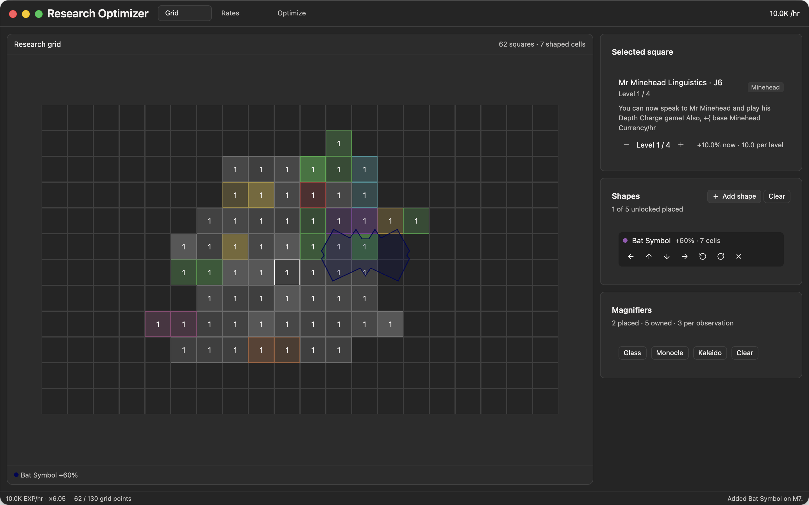
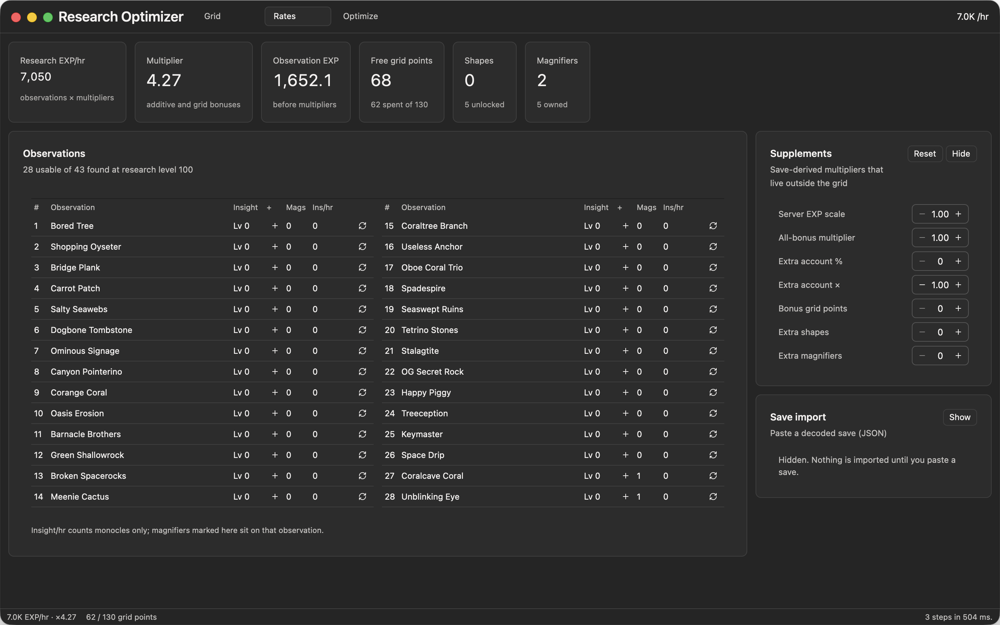
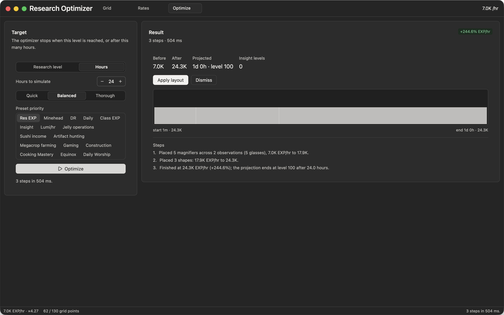

# Idleon Research Optimizer

A native desktop rebuild of
[Corgan/idleon-research-optimizer](https://github.com/Corgan/idleon-research-optimizer) in Rust with
[GPUI](https://github.com/zed-industries/zed/tree/main/crates/gpui) and
[Ely](https://elygpui.com) components. The upstream runs its simulations in browser workers; this app
runs them in a local Rust core, so a shape, magnifier and grid-point pass costs milliseconds and can
afford a real search instead of a heuristic.



| Rates | Optimize |
| --- | --- |
|  |  |

## What it does

- **The research grid** — the 20×12 board of upgradeable squares with their goal colours and levels,
  and the ten research shapes as real polygons over it: add, nudge, rotate (5° steps), remove.
  Arrow keys walk the squares, `=`/`-` level the selected one, Escape drops the selection.
- **Local simulation** — research EXP/hour with its additive and multiplicative breakdown, insight
  levelling per observation, magnifier caps, grid points earned and spent, shapes and magnifiers
  owned, and an event-driven projection to a research level or an hour budget.
- **Three optimizers, all in-process and parallel**
  - shape placement: greedy over the preset's target priorities, then a lattice search on the real
    EXP rate (moves, rotation sweeps once level 90 unlocks them, shape-order swaps);
  - magnifier assignment: two greedy orders kept best-of, then repair moves and swaps; kaleidoscopes
    weigh the neighbours that actually hold glasses, monocles go to the best insight ROI;
  - grid-point spending: marginal climb as the incumbent, a whole-layout beam search over the
    unlocked squares that wins when it can, then a refine pass that moves points; levels on the
    magnifier-grant squares are priced with the pool they unlock.
- **Sixteen presets** — Res EXP, Minehead, DR, Insight, Lumi/hr, Sushi, Gaming, Construction, … as
  placement priorities.
- **Supplements** — the save-derived multipliers that live outside the grid (`serverVarResXP`,
  all-bonus multiplier, extra account %, extra multiplier, flat grid points, extra shapes and
  magnifiers), editable in the Rates pane; the displayed rate follows each change.
- **Save import** — paste a decoded game save (JSON) and the grid levels, shape positions,
  magnifiers, insight, research level/EXP, server scale, all-bonus multiplier, flat grid points and
  the decodable true multipliers are read from it. Fields the app cannot model are reported as
  warnings instead of guessed; unreadable saves leave the run untouched.
- **Projection chart** — EXP/hour across the run, from an event-driven simulation that levels insight
  as it goes.

## Run

```console
git clone --recurse-submodules https://github.com/<you>/idleon-optimizer
cd idleon-optimizer
cargo run --release
```

The first build compiles GPUI from source; expect a few minutes. `cargo run` opens the window with a
legal starter layout at research level 100 so every pane has something to show.

## Stack pins

The app, the component kit and the automation bridge must share one GPUI build:

| Piece | Pin |
| --- | --- |
| GPUI | `gpui-pre = 0.3.9` (crates.io, patched to the bridge's vendored tree) |
| `gpui_platform` | `gpui-pre-platform = 0.3.9` with `font-kit`, `wayland`, `x11` |
| Ely | `ely-gpui-component`, rev `28e5690` |
| gpui-mcp | submodule `vendor/gpui-mcp`, branch `gpui-pre-0.3.9`, commit `ac15850` |

Newer Ely releases pin `gpui-pre 0.3.10`/`0.3.11` and the bridge patches up to `0.3.9`, so these are
the intersection. Bumping any one means moving all three together; the smoke script is the check.

## Verifying

```console
cargo test                                  # core maths, geometry and optimizer invariants
cargo run                                    # then, in another shell:
node script/mcp-smoke.mjs --shot /tmp/ui.png # lists the app, reads the UI tree, screenshots it
node script/mcp-drive.mjs                    # clicks through grid → shapes → optimize → apply
```

`script/mcp-drive.mjs` talks to the app through
[gpui-mcp](https://github.com/mastro993/gpui-mcp) over stdio: it asserts the grid is exposed as
semantic nodes, that a click selects a square, that adding a shape lists it, that a run produces a
result, that the result never loses EXP, and that applying it clears the result. Both scripts need the
`gpui-mcp` binary (`cargo install --git https://github.com/mastro993/gpui-mcp --branch gpui-pre-0.3.9 gpui-mcp-server`)
and a running app.

If background subagent launches fail with a missing `@earendil-works/chord`, run
`node script/install-pi-chord.mjs` (idempotent, re-run after a Pi upgrade) — see
[`docs/agent-harness.md`](docs/agent-harness.md).

To let an agent drive the window itself, the repo ships `.pi/mcp.json` registering the same server as
`gpui`; `get_ui_tree`, `click_element`, `type_text`, `screenshot` and `wait_for_element` then work
against this app. Every control in the UI carries a stable id for that purpose (`cell-129`,
`shape-add`, `shape-rotate-right`, `run-optimize`, `apply-result`, …).

## Layout

```
crates/core        game data, geometry, simulation maths, optimizers   (no GPUI)
  data/research.json  extracted from the upstream repo
crates/app         GPUI + Ely window: grid canvas, inspector, rates, optimize pane
script/            data extraction, MCP smoke and drive harnesses
docs/plan.md       scope, architecture, maths and work plan
vendor/gpui-mcp    submodule pinned to the bridge's GPUI branch
```

## Data

`crates/core/data/research.json` is generated from the upstream JS by
`node script/extract-research-data.mjs <path-to-upstream-repo>`: 62 grid squares, 10 shapes with
vertices and dimensions, 43 observations, and the sixteen presets' target squares. Re-run it when
the upstream tables move.

## Scope

v1 covers the research grid and its optimizers. Not included: save-file import (the upstream reads
the game save through Google sign-in; this app takes account multipliers as supplement inputs), and
the other calculators in the upstream repo (combat sim, sailing, cooking, royal guardian, …).

The formulas are ports of `js/stats/systems/w7/research-math.js`. Save-specific multipliers collapse
into `SimContext::{extra_pct, extra_multiplier, all_bonus_multi}`; the presets use their static target
lists rather than the save-dependent `build` functions.
