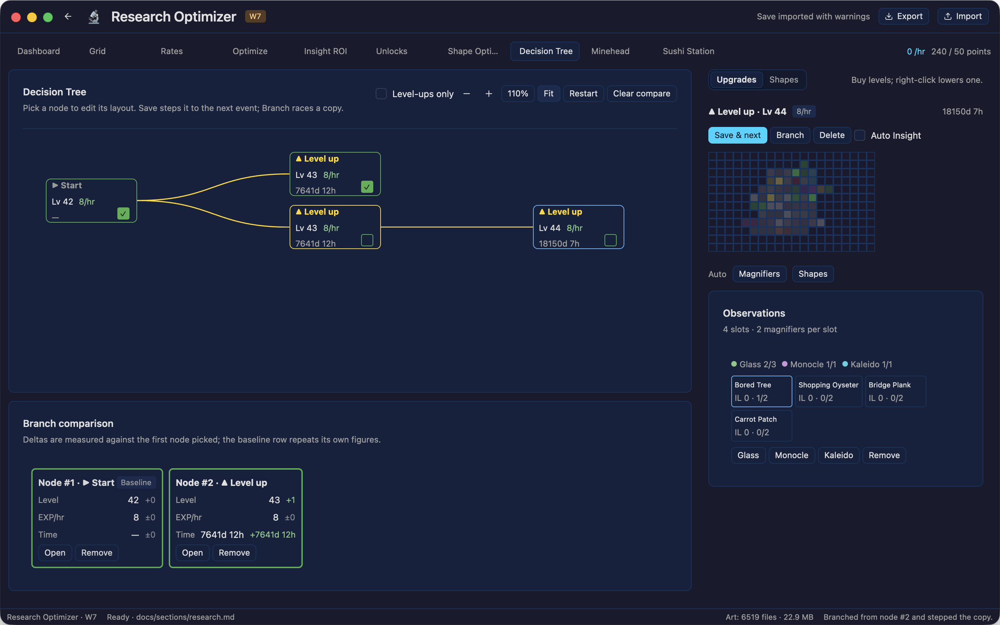

# Decision Tree

The research page's Decision Tree sandbox. The maths lives in
`crates/research/src/tree.rs` and the tab itself is `crates/app/src/sections/research/tree.rs`.

## What it answers

The optimizer projects one path to a target. The tree lets you ask what happens next from any point:
save a node to step it to the next research or insight level-up, branch a node to race a different
layout from the same state, and compare the branches side by side. Every node carries a full
simulation state — grid levels, observation insight, magnifiers and shapes — so a step is exactly
the next event that state reaches, not an interpolation.

## Nodes and events

The root is the loaded save, or a run's result when it was opened from the Optimizer tab. Saving a
node jumps its state to the closest of:

- the next research level-up (`research_exp_req` against the node's EXP/hour), or
- the next insight level-up (the soonest `insight_exp_required` over every observation holding a
  monocle).

The EXP rate is constant between events, so the step applies the EXP that jump earns and the one
insight collection it causes. The new node records which event opened it, the hours from its parent
and the observations whose insight level rose.

Nodes are drawn in time columns: each event is a column, placed `140px` apart plus a square-root
scaled gap, capped so a years-long level does not push the next column off the canvas. Siblings
stack in rows. The canvas pans by dragging the background and zooms with the toolbar; **Fit** frames
the whole tree, and **Level-ups only** hides the insight nodes while keeping the level-ups they lead
to.

## Auto Insight

A node can be marked **Auto Insight**. Saving it then steps through every insight level-up on the
way, re-fitting the monocles at each with `choose_mono_targets`, and stops at the next research
level-up. The skipped insight nodes stay in the model but are hidden from the canvas; the level-up
node carries the timeline of everything the chain passed through (hours, observation, old and new
insight level, EXP/hour after the re-fit).

Monocle targeting (`crates/research/src/optimize/monos.rs`) prices each usable observation by how
soon it levels insight and, where the grid reads insight for EXP, by the EXP/hour that level
permanently buys, with the regular magnifiers re-fitted for the projected insight. Auto Mags places
glasses and kaleidoscopes for the rate, reserving room for monocles, then spreads the monocles with
the same targeting.

## The node editor

The selected node's editor holds:

- **Upgrades**: click a square on the board to buy its next level; right-click lowers it.
- **Shapes**: nudge and turn the placed shapes; **Auto Shapes** places them for the rate.
- **Observations**: the magnifier pool with its free counts, one card per usable observation, and
  the buttons that place or lift a magnifier on the picked one.

All of it edits that node's own state. **Save & next** steps the node, **Save & re-sim** re-runs its
children from the edited state (a hidden Auto Insight chain is rebuilt and keeps its descendants),
**Branch** copies the node and steps the copy, and **Delete** removes a branch and everything under
it. The root cannot be deleted.

## Comparison

Every node's corner box adds it to the comparison panel. The first node picked is the baseline, and
the panel lists level, EXP/hour and time with the delta against that baseline — so two branches from
the same state show what each layout bought. The baseline row repeats its own figures with zero
deltas.

## Verification

`crates/research/tests/tree.rs` builds a tree from the committed account fixture and checks that a
stopped Auto Insight chain returns nothing and leaves the tree as it was.

The research lane in `script/mcp-sections.mjs` drives the tab end to end: it opens the tree from the
loaded save, assigns a glass, saves a node, compares two branches, branches and deletes a fork, runs
Auto Mags and Auto Shapes, and lets Auto Insight land on a research level-up.
