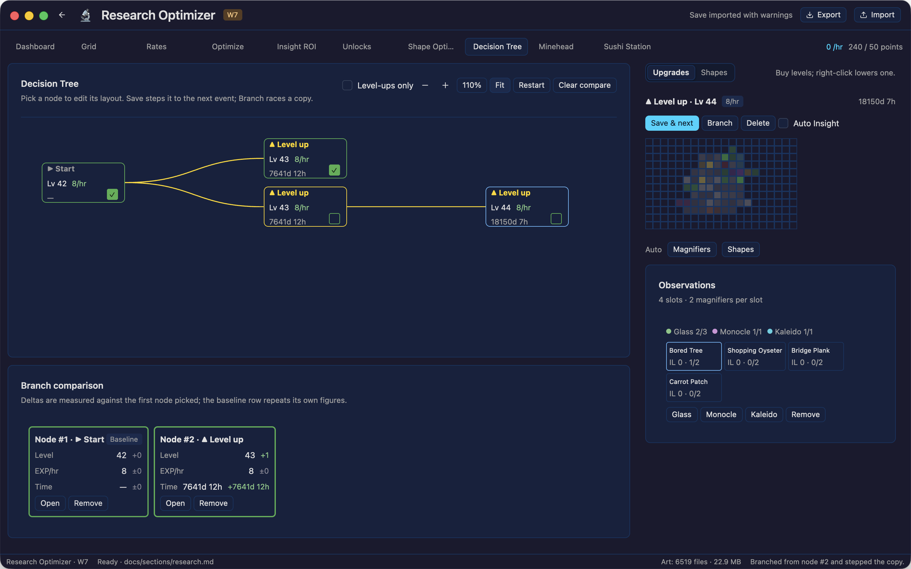

# Decision Tree

The research page's Decision Tree sandbox, ported from the upstream calculator. The maths lives in
`crates/research/src/tree.rs` and the tab itself is `crates/app/src/sections/research/tree.rs`.



## What it answers

The optimizer projects one path to a target. The tree lets you ask what happens next from any point:
save a node to step it to the next research or insight level-up, branch a node to race a different
layout from the same state, and compare the branches side by side. Every node carries a full
simulation state — grid levels, observation insight, magnifiers and shapes — so a step is exactly
the next event that state reaches, not an interpolation.

## Upstream sources

| Part | Upstream |
| --- | --- |
| The stepper and node model | `js/dt/dt-sim.js` (`dtStepSim`, `dtAdvanceAutoInsight`, `dtResimChildrenOf`) |
| The tree, layout and comparison | `js/dt/decision-tree.js` |
| The node board | `js/dt/dt-grid.js` |
| The observation editor | `js/dt/dt-obs-editor.js` |
| Auto Insight's monocle targets | `js/optimizers/monos.js` (`chooseMonoTargets`) |
| The auto magnifier fit | `js/optimizers/magnifiers.js` (`optimizeMagsFor`) |
| The auto shape fit | `js/sim-engine.js` (`optimizeShapesFor`) |
| The formulas | `js/stats/systems/w7/research-math.js` |

## Nodes and events

The root is the loaded save, or a run's result when it was opened from the Optimizer tab. Saving a
node jumps its state to the closest of:

- the next research level-up (`researchExpReq` against the node's EXP/hour), or
- the next insight level-up (the soonest `insightExpReqAt` over every observation holding a
  monocle).

The EXP rate is constant between events, so the step applies the EXP that jump earns and the one
insight collection it causes, as upstream `dtStepSim` does. The new node records which event opened
it, the hours from its parent and the observations whose insight level rose.

Nodes are drawn in time columns: each event is a column, placed `140px` apart plus a square-root
scaled gap, capped so a years-long level does not push the next column off the canvas. Siblings
stack in rows. The canvas pans by dragging the background and zooms with the toolbar; **Fit** frames
the whole tree, and **Level-ups only** hides the insight nodes while keeping the level-ups they lead
to.

## Auto Insight

A node can be marked **Auto Insight**. Saving it then steps through every insight level-up on the
way, re-fitting the monocles at each with upstream `chooseMonoTargets`, and stops at the next
research level-up. The skipped insight nodes stay in the model but are hidden from the canvas; the
level-up node carries the timeline of everything the chain passed through (hours, observation, old
and new insight level, EXP/hour after the re-fit).

Monocle targeting is the port of `js/optimizers/monos.js`: each usable observation is priced by how
soon it levels insight and, where the grid reads insight for EXP, by the EXP/hour that level
permanently buys, with the regular magnifiers re-fitted for the projected insight. Auto Mags places
glasses and kaleidoscopes for the rate with `optimizeMagsFor`'s reservation for monocles, then spreads
the monocles with the same targeting.

## The node editor

The selected node's editor holds:

- **Upgrades**: click a square on the board to buy its next level; right-click lowers it.
- **Shapes**: nudge and turn the placed shapes; **Auto Shapes** places them for the rate.
- **Observations**: the magnifier pool with its free counts, one card per usable observation, and
  the buttons that place or lift a magnifier on the picked one.

All of it edits that node's own state. **Save & next** steps the node, **Save & re-sim** re-runs its
children from the edited state (a hidden Auto Insight chain is rebuilt and keeps its descendants),
**Branch** copies the node and steps the copy, and **Delete** removes a branch and everything under
it. The root cannot be deleted.

## Comparison

Every node's corner box adds it to the comparison panel. The first node picked is the baseline, and
the panel lists level, EXP/hour and time with the delta against that baseline — so two branches from
the same state show what each layout bought. The baseline row repeats its own figures with zero
deltas.

## Verification

`fixtures/decision-tree.json` is written by `script/decision-tree-oracle.mjs` from upstream
`dtBuildInitState`, `dtStepSim` and `dtAdvanceAutoInsight`:

```console
node script/decision-tree-oracle.mjs /path/to/idleon-research-optimizer
```

It carries two chains. The first steps the committed `fixtures/data.json` account twelve events
through the upstream stepper; the second uses a small synthetic state that reaches insight level-ups
within hours, so the auto-insight chain (including its monocle re-fits and timeline) is compared
against the calculator too. `crates/research/tests/tree.rs` rebuilds both states from the fixture and
compares every event's type, hours, level and EXP/hour, and the auto chain's nodes and timeline.

The research lane in `script/mcp-sections.mjs` drives the tab end to end: it opens the tree from the
loaded save, assigns a glass, saves a node, compares two branches, branches and deletes a fork, runs
Auto Mags and Auto Shapes, and lets Auto Insight land on a research level-up.
