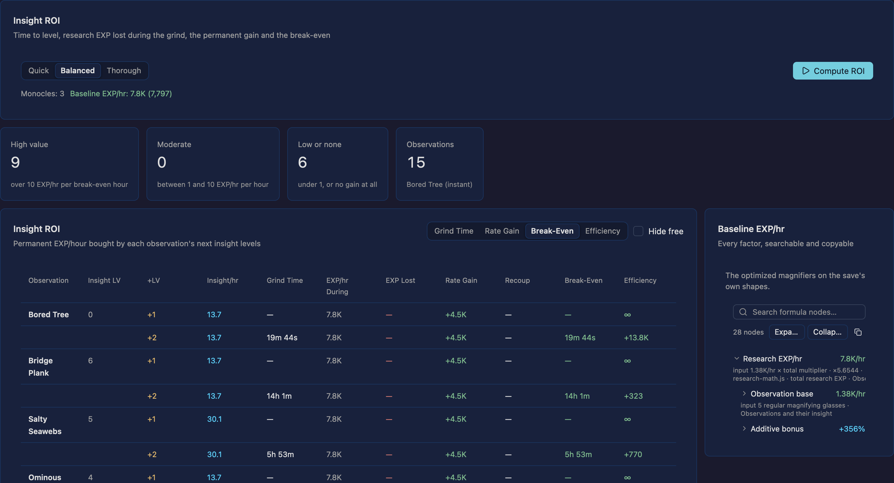

# Insight ROI

The research page's Insight ROI tab, ported from the upstream calculator. The maths lives in
`crates/research/src/insight.rs` and the tab itself is
`crates/app/src/sections/research/insight_roi.rs`.



## What it answers

Insight levels are bought with time, not EXP: a monocle on an observation earns insight EXP/hour,
and collecting enough of it costs the research EXP/hour the grind layout gives up. The tab prices
that trade for every observation a magnifier can sit on and ranks the rows by break-even time.

## Upstream sources

| Part | Upstream |
| --- | --- |
| The analysis | `js/analysis.js` (`computeInsightROI`, `computeInsightCellValues`) |
| The grind layout | `js/optimizers/monos.js` (`buildConcentratedLayout`) |
| The post-grind layout | `js/sim-engine.js` (`optimizePostGrind`) |
| The table and its controls | `js/renderers/render-analysis.js` (`_renderInsightROITable`) |
| The formulas | `js/stats/systems/w7/research-math.js` (`insightExpRate`, `insightExpReqAt`, `getAvailableSlots`, `simTotalExpWith`) |

## Columns

| Column | Meaning |
| --- | --- |
| Observation | Every observation that is found and past its research-level requirement (`getAvailableSlots`). |
| Insight LV | Its insight level before the grind. |
| +LV | The scenario: one insight level, or two. |
| Insight/hr | Insight EXP/hour the grind earns on it. |
| Grind Time | `insightExpReqAt(obs, level)` over that rate, for each level in the scenario. |
| EXP/hr During | Research EXP/hour the grind layout earns. |
| EXP Lost | `max(0, baseline − during) × grind time`, and nothing when the grind gives up no EXP. |
| Rate Gain | The permanent research EXP/hour the new insight level adds, with the post-grind layout re-optimized for the new insight levels. |
| Recoup | `EXP lost ÷ rate gain`, endless with no gain. |
| Break-Even | `grind time + recoup`. |
| Efficiency | `rate gain ÷ break-even`, the upstream triage metric: over 10 is high value, over 1 moderate. |

The baseline is the optimized magnifier layout on the save's own shapes, so a row is measured
against the best non-grind layout rather than against whatever mid-grind layout the grid is in.

## The grind layout

`buildConcentratedLayout`, ported as `insight::concentrated_layout`:

1. Move every monocle onto the target up to its per-observation cap, evicting the glasses and
   kaleidoscopes that were there.
2. Overflow monocles go to the observation where a monocle earns the most insight.
3. Evicted magnifiers go to the slot that keeps the most observation EXP.
4. Kaleidoscopes move one at a time while that costs less EXP per insight gained.

The shapes the grind would use are scored mostly on insight (70%) and partly on research value
(30%), placed by the greedy pass of the shape optimizer with those values; the tab only grinds with
them when the resulting break-even beats the save's own shapes, which is the upstream choice.

## Controls

- **Effort** — Quick, Balanced or Thorough, the same search depth the rest of the section uses; the
  analysis runs off the UI thread through the shared task runner and can be cancelled without
  losing the previous table.
- **Sort by** — Grind Time, Rate Gain, Break-Even (the default) and Efficiency.
- **Hide free** — drops rows whose grind loses no EXP. Upstream starts with it on; this build starts
  with it off so a first run lists the whole table.
- **Baseline EXP/hr** — the shared formula tree over the baseline layout, searchable and copyable.

## Tests

`crates/research/tests/insight.rs` compares the port with the upstream calculator's own output in
`fixtures/research-roi.json`, regenerated by:

```console
node script/research-roi-oracle.mjs /path/to/idleon-research-optimizer
```

The fixture covers the usable observation list, the magnifier cap, the insight rate and the insight
requirement curves, the EXP totals for a layout and a levelled copy, and the concentrated layout the
upstream builder places for two targets. The full-account fixture run is
`#[ignore]`d as the long simulation it is; `cargo test -- --include-ignored` runs it.

`node script/mcp-sections.mjs --only research` drives the tab: it puts a monocle in the pool, opens
the tab, computes the table, sorts it and checks the summary totals.
