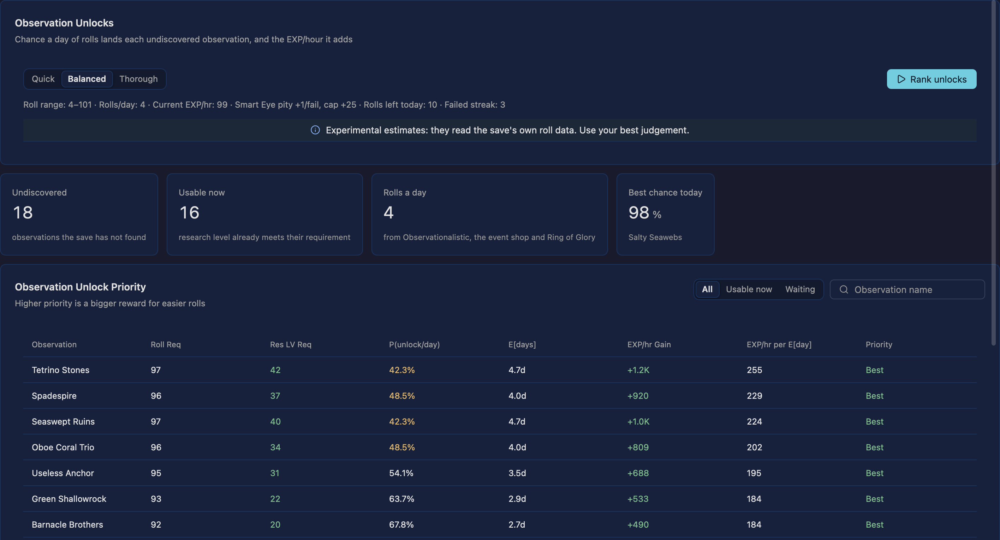

# Observation Unlocks

The research page's Observation Unlocks tab, ported from the upstream calculator. The maths lives
in `crates/research/src/unlock.rs` and the tab itself is
`crates/app/src/sections/research/unlocks.rs`.



## What it answers

An observation you have not found yet costs a roll to land, and a day only has so many rolls. The
tab ranks every undiscovered observation by what finding it adds per day of hunting: the research
EXP/hour it is worth divided by the expected days to the first successful roll. The reward is easy
to read — a row with a big gain and a short wait is the one worth rolling for.

## Upstream sources

| Part | Upstream |
| --- | --- |
| The analysis | `js/analysis.js` (`computeObsUnlockPriority`) |
| The candidate layout | `js/optimizers/magnifiers.js` (`optimizeMagsFor`) |
| The save inputs | `js/save/context.js` (`buildSaveContext`) |
| The table and its summary | `js/renderers/render-analysis.js` (`renderObsUnlock`) |
| The observation table | `js/game-data.js` (`OCC_DATA`: `roll` is the research level, `rollReq` the roll) |
| The formulas | `js/stats/systems/w7/research-math.js` (`simTotalExpWith`, `computeOccurrencesToBeFound`) |
| The mastery roll bound | `js/stats/systems/w7/research-math.js` (`researchMasteryBonuses`) |

## Rows

One row per observation within `computeOccurrencesToBeFound` that the save has not found:

| Column | Meaning |
| --- | --- |
| Observation | Its name. |
| Roll Req | `OCC_DATA[t].rollReq`: the roll that unlocks it. |
| Res LV Req | `OCC_DATA[t].roll`: the research level that unlocks it; `(wait)` when the level is not there yet. |
| P(unlock/day) | The chance today's remaining rolls land it, with the failed-roll pity applied to each roll. |
| E[days] | Expected days to the first success, given the rolls a day, the pity and the failure streak. |
| EXP/hr Gain | Research EXP/hour the observation adds: the re-placed magnifier layout with it found, minus the save's own layout rate. Zero until the research level can use it. |
| EXP/hr per E[day] | `gain ÷ expected days`, the ranking score. |
| Priority | `Best` at 70% of the best score, `Good` at 30%, `Low` below that, and `Wait` when the level requirement is unmet. |

Rows are ordered the upstream way: the usable ones first, then by score, highest first.

## The roll maths

The save gives the two bounds a roll can land in:

- the minimum is `1 + min(failed rolls × Smart Eye levels, 25 × Smart Eye levels) + mastery`, so a
  losing streak raises it, and research mastery past 200 total levels adds one more;
- the maximum is `100 + Sharp Eye + Ring of Glory 30 + Jelly reward 12 + mastery`, where mastery
  past 1000 total levels adds one more.

Rolls a day are `3 + Observationalistic level + 3 × event shop 35 + Ring of Glory 2`. A roll lands
the observation when it reaches its requirement, so a day's chance is
`1 − P(every roll misses)` and the expected days follow the same model until the chance of not
having found it falls under 0.01%, the upstream 365-day bound.

## Missing roll data

`Research[7][2]` (rolls left today) and `OptLacc[514]` (the failed-roll streak) are not in every
save, and upstream silently reads a missing one as zero, which presents an estimate as truth. This
build keeps them optional: the patched save fields are warned about at import with their names, the
tab lists them in a warning banner, and every probability, expected time and score shows `—` until
both are present. The EXP/hour gain still shows, because it does not depend on the rolls.

## Controls

- **Effort** — Quick, Balanced or Thorough, the same search depth the rest of the section uses. The
  ranking runs off the UI thread through the shared task runner and can be cancelled without losing
  the previous table.
- **All / Usable now / Waiting** — filters the table by the research-level requirement.
- **Find an observation** — narrows the table by name.
- The summary names the roll range, the Smart Eye pity, the rolls a day and the rolls left today.

## Tests

`crates/research/tests/unlock.rs` compares the port with the upstream calculator's own output in
`fixtures/obs-unlock.json`, regenerated from the committed account fixture by:

```console
node script/obs-unlock-oracle.mjs /path/to/idleon-research-optimizer
```

The fixture loads `fixtures/data.json` through the upstream save loader, so it carries the calculator
page's own answer for that account: the roll bounds, the rolls a day, the current rate, the priority
ordering and every row's chance, expected days, gain and score. The port is compared term by term;
the rate terms use the documented 1e-4 tolerance for the Tome star talent slot this build does not
model, and the ordering is exact.

`node script/mcp-sections.mjs --only research` drives the tab: it runs the ranking, checks the roll
summary and the KPIs, narrows the table with each filter and the name search, and then imports a
save without the roll rows to prove the missing-data report.
