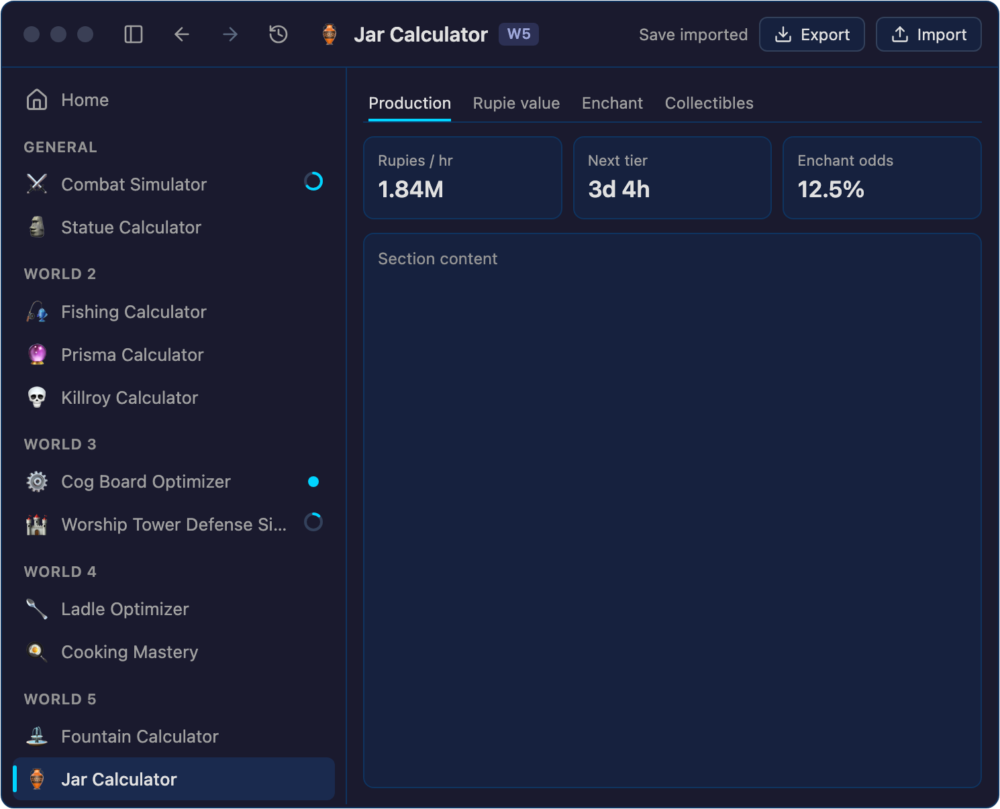
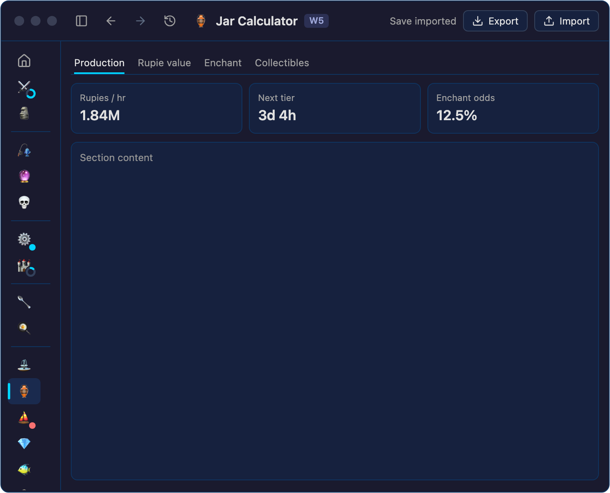
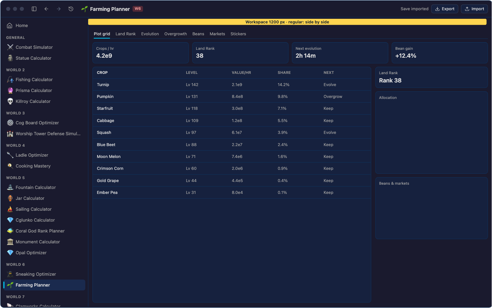
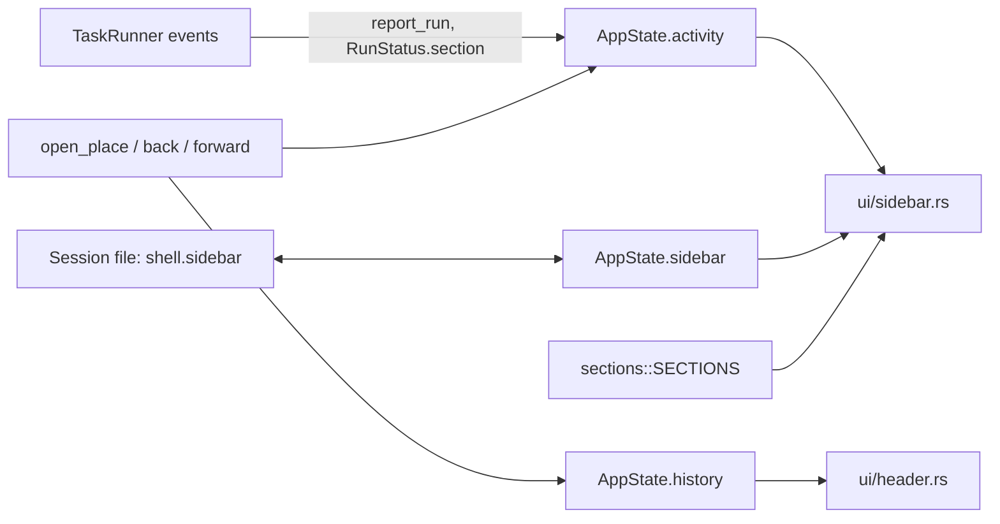

# App shell: sidebar, header and section activity

Terms follow [`GLOSSARY.md`](../../GLOSSARY.md).

## Problem

Moving between sections goes back through the Home card grid every time: the header's only way
out of a section is "Back to dashboard" (`ui/layout.rs`, `back_button`). Runs in different sections
already run side by side (each section owns its `TaskRunner`s; `start_run` only refuses a runner
that is already busy, `state/runs.rs`), but nothing shows a run outside its own section except the
one shared status line, where the last message wins. So a user who starts a farming allocation and
moves to Sailing cannot see it progress or notice it finish.

Section state already survives navigation and restarts (`plan.md` §3, `section-state.md`); this
feature keeps that as it is.

## Outcome

From any section the user opens any other in one click, steps back and forward through the places
they visited, and sees every section's runs (running with progress, finished while away, failed)
on its sidebar item, expanded or folded to the rail. The fold survives a restart.

## Scope

In: the header, the sidebar with its groups and game-art icons, the rail toggle and its
persistence, page-level history with shortcuts, the activity marks, a test that proves two
sections run at once.

Out: how runs work, section content and tab strips, the theme, the dashboard grid's own layout,
persisting history or activity marks.

The bottom status bar was removed in S1 at the owner's request; the status message stays as a
zero-size labelled node (`status-status`) for screen readers and the harnesses, and the sidebar's
activity marks (S3) are what shows a run's state.

## Behavior

Decisions agreed with the owner:

1. **D1 – Home stays.** The sidebar's first entry is Home, which opens today's card grid
   (`Route::Dashboard`). First launch, and a launch with no last section, land on Home.
2. **D2 – Activity marks.** While any run of a section is in flight its item shows a progress ring
   (the least advanced run's fraction; the tooltip says "Running · 42%", or "2 runs · 42%").
   A run that stores a result while another place is open leaves an accent dot; a run that
   panics while another place is open leaves a red dot. Opening the section clears both. A run
   the user cancels leaves no mark. A new run replaces a dot with the ring. In the rail the mark
   sits on the icon's bottom-right corner.
3. **D3 – History is page-level.** Each place opened (Home, a section, a missing id) is one step;
   tab switches inside a section are not. Opening a place after going back drops the forward
   steps. Opening the place already shown adds nothing.
4. **D4 – Tools are listed.** The sections with no dashboard card (`stats-all`, `damage`,
   `drop-rate`, `coin-multi`, `pickle`) appear in a Tools group at the bottom of the sidebar. The
   dashboard still hides them.
5. **D5 – Mark placement (prototype pick A).** Expanded: the mark sits at the row's end, a 14 px
   ring (2 px stroke) or an 8 px dot. Rail: it sits on the icon's bottom-right corner, offset 5 px
   out, a 12 px ring (2.5 px stroke) or an 8 px dot, on a disc in the row's background colour so it
   stays readable on a sprite. Rejected: a 30 px ring around the icon (crowds the 32 px rows,
   clips square sprites); a 2 px bar along the row (invisible at low progress).
6. **D6 – Width (prototype pick B).** The compact breakpoint drops from 1360 px to 1180 px and is
   measured on the workspace (window minus sidebar), so a 1440 px window keeps side rails beside
   their pane whether the sidebar is expanded (1200 px) or folded (1384 px). The prototype checked a
   330 px rail; the widest is 440 px (see A7). Rejected: keeping
   1360 px, which stacks every page at the default window while the sidebar is expanded.

Flows:

- **Open a section.** Click its sidebar item: the section opens in the state it was left in, the
  item turns active and its finished or failed dot clears. Clicking Home shows the grid. The header
  carries no place title (owner's call after the S1 review): the active item names the place.
- **Fold the sidebar.** Click the toggle (`IconName::PanelLeft`) at the header's left: the sidebar animates from 240 px
  (icon and title, group headings) to the 56 px rail (icons only, title in a tooltip, short group
  headings) and back. The choice is written to the session file and restored at launch; the
  default is expanded.
- **Go back and forward.** The arrows beside the toggle, or Cmd/Ctrl+[ and Cmd/Ctrl+] (also
  Cmd/Ctrl+Left and Right), move through the history; an arrow is disabled at its end. Ely's
  history list button beside them lists every place, newest first. History starts empty at each
  launch.
- **Run in two sections.** Start the Farming allocation, open Sailing, start its simulation: both
  run, both items show a ring, and the status message (read by screen readers) keeps the latest one.
  When Farming finishes, its ring becomes an accent dot until Farming is opened.
- **Import a save.** The import discards the runs it invalidates (as today) and clears every
  finished and failed dot, because the results they pointed to may be gone.
- **Missing id.** `--section <unknown>` still renders the missing-section state; no sidebar item is
  active, and the missing-section state names the id.
- **Narrow window.** At the 1080 × 680 minimum, both sidebar states fit; the sidebar scrolls when
  its items are taller than the window.

## UX

Approved in a prototype round (variants and references: `.ux-brainstorm/20261116-app-shell/`,
local to the owner's machine only). The icons below are the current emoji; slice 4 swaps in the
game sprites.

| Expanded, activity marks (D5) | Rail, activity marks (D5) |
|---|---|
|  |  |

### Component map

| Element | Renders with |
|---|---|
| Header bar | the existing `header_bar` (`ui/layout.rs`), moved to `ui/header.rs`; keeps the 84 px traffic-light inset and 48 px height |
| Sidebar toggle | Ely `IconButton` (`IconName::PanelLeft`, ghost, `ControlSize::Sm`) |
| Back, forward, history list | Ely `BackForwardNavigation` |
| Save status, Export, Import | the existing `save_actions` (`ui/layout.rs`) |
| Sidebar column and fold animation | Ely `layout::Sidebar` (240 / 56 px from `theme.sidebar_width`) |
| Group heading | Ely `NavGroup` for the items (folded, so it draws no title); the title is an app label in `NavGroup`'s type without its fold chevron (headings do not fold, A4); in the rail, a short form centred over the icons |
| Sidebar item | app `SidebarItem` (`ui/sidebar.rs`, ADR 0003): `NavItem`'s height, radius, hover, active fill (no accent bar) and focus ring; a 20 px manifest image; tooltip when folded |
| Running mark | Ely `ProgressRing` (14 px expanded, 12 px rail) |
| Finished / failed mark | Ely `DotBadge` (8 px), accent / danger |
| Rail corner disc | a circle in the row's current background (`bg`, or `hover` when active or hovered) |

### Tokens

All existing (`ui/theme.rs` and Ely's theme): `bg`, `surface`, `hover`, `border`,
`border_strong` (ring track), `fg`, `fg_muted`, `fg_subtle` (group headings), `accent` (ring arc,
finished dot), Ely `danger` (failed dot), `tooltip_bg`/`tooltip_fg`, Ely
`radius(Md)`, `control_height(Md)` (32 px rows), `sidebar_width`. No new tokens.

### Copy

| Where | Text |
|---|---|
| Toggle tooltip and label | "Collapse sidebar" / "Expand sidebar" |
| Arrows | "Back", "Forward"; history list "History" (Ely's own) |
| Home item | "Home" |
| Group headings | "General", "World 2" … "World 7", "Tools" (`Group::label`); in the rail "Gen", "W2" … "W7", "Tools" |
| Running mark tooltip and aria label | "Running · 42%"; "2 runs · 42%" |
| Finished / failed aria label | "Finished" / "Failed" |
| Rail item tooltip | the section title, then " · " and the mark text when it has one |
| Save status | unchanged (`SaveStatus::label`) |

### Interactions and focus

- Tab order: toggle, back, forward, history, Export, Import, then the sidebar items top to bottom,
  then the workspace. Enter or Space on a focused item opens it.
- Clicking an item opens it (D1–D4); clicking the active item does nothing.
- The toggle flips expanded and rail with Ely's width animation and saves the choice.
- Cmd/Ctrl+[ and Cmd/Ctrl+] (also Cmd/Ctrl+Left and Right) go back and forward from any place.
- The sidebar scrolls on its own; the active item is scrolled into view when a place opens.

## Design

- **Shell layout** (`ui/shell.rs`): header across the full width, then a row of sidebar and
  workspace (no status bar). `layout::page_header`, `dashboard_header`, `missing_header` and
  `back_button` merge into one `ui/header.rs`, which holds no place title.
  ([ADR 0001](../adr/0001-sidebar-is-the-primary-navigation-and-home-keeps-the-grid.md))
- **Sidebar** (`ui/sidebar.rs`): Ely `Sidebar` with one `NavGroup` per `Group` in `Group::ALL`
  order; the Tools group lists every entry with `dashboard: false` (so `stats-all` appears under
  Tools, not General). Items are the app's `SidebarItem`.
  ([ADR 0003](../adr/0003-sidebar-items-are-built-in-the-app-from-ely-parts.md))
- **Activity** (`state/activity.rs`): `Activity` maps a section id to its runners' state (by
  runner `EntityId`: running fraction) and to an optional `Mark::{Finished, Failed}`. `RunStatus`
  gains `section: &'static str`; `report_run` records `Progress` (running), and `Finished` (clear
  running; set the mark when the route is not that section). `TaskEvent::Finished` becomes
  `Finished(Ending)` with `Ending::{Stored, Cancelled, Failed}`, `Failed` meaning the job panicked
  (`crates/ui/src/runner.rs`). Opening a section and applying an import clear marks.
  ([ADR 0002](../adr/0002-section-activity-is-pushed-from-runner-events.md))
- **History** (`state/history.rs`): `History { places: Vec<Route>, current: usize }`, capped at 50
  places, not persisted. `open_section` and `back_to_dashboard` become one `open_place(route)`
  that pushes; `go_back`/`go_forward` move `current` without pushing. Rendered with Ely's
  `BackForwardNavigation`. `shell::bind_keys` swaps `BackToDashboard` (Escape, secondary-left) for
  `GoBack`/`GoForward` (secondary-[, secondary-], secondary-left, secondary-right) bound in the
  window's root context, so they work on Home too.
- **Fold persistence** (`session.rs`): the session file gains an additive `"shell": {"sidebar":
  "expanded" | "rail"}` key beside `project`; `VERSION` stays 1 because older builds ignore it.
  It is window-local memory, so it never enters the project export.
- **Breakpoint** (`ui/layout.rs`, D6): `COMPACT_WIDTH` becomes 1180 px and `Breakpoint::of`
  measures the workspace (viewport minus the sidebar's current width, published by the shell as a
  gpui global) instead of the viewport. The 15 call sites gain `cx`. Card minimums and
  `split_pane` widths are unchanged.
- **Icons** (`sections/mod.rs`, `assets/game/sections/`): each registry entry gains `art`, a
  manifest reference to one game sprite chosen per section (taken under the rules in
  `docs/game-data-sources.md` and `plan.md` §2, with manifest entries). The emoji `icon` stays as
  the fallback when the sprite is missing, since a labelled placeholder does not fit a 20 px slot.
  Home uses Ely's `IconName::House`. The dashboard cards switch to the same art.
- **Ids for the harness**: `app-sidebar`, `sidebar-toggle`, `nav-home`, `nav-group-<group>`,
  `nav-<section>`, `nav-<section>-activity` (aria label "Running 42%", "Finished", "Failed"),
  the history arrows under `history`. `card-<id>` stays.

## Assumptions

- **A1** No one has seen a run in one section block another; the requirement is guarded by a test,
  not a fix. If it has happened, a bug slice comes first.
- **A2** The header shows no place title; the active sidebar item names the open place.
- **A3** Escape no longer leaves a section (the sidebar makes it unnecessary); sections that bind
  Escape deeper keep it.
- **A4** Group headings do not fold; the sidebar scrolls. Rail mode shortens the headings
  ("Gen", "W2" … "W7", "Tools") instead of separating the groups with lines (owner's call after
  the S1 review).
- **A5** Several runs in one section show one ring at the least advanced fraction.
- **A6** History and activity marks live only for the window's lifetime.
- **A7** 1180 px suits every section's side rail (330–440 px; the 440 px one leaves its main pane about
  730 px at a 1200 px workspace); slice 1 screenshots each
  section at a 1440 px window in both sidebar states, and a section whose rail clips gets its own
  narrower rail rather than a higher global breakpoint.
- **A8** The UI keeps saying "calculator" where it does today; code keeps `section`.

## Acceptance

1. Every registry entry has a sidebar item under its group, the five dashboard-hidden ones under
   Tools, and Home first. (S1)
2. Clicking an item opens that section in the state it was left in, and the item is marked
   active. (S1)
3. The toggle folds the sidebar to the rail and back; after a relaunch the fold is restored; a
   session file without the `shell` key opens expanded. (S1)
4. Import, Export and the save status sit at the header's right on every place. (S1)
5. Back and forward step through places only, drop forward steps after a new open, and work from
   the arrows and from both shortcut pairs; Escape on a section no longer opens Home. (S2)
6. Two sections' runs are in flight at the same time and both store their results (headless test). (S3)
7. A running section's item shows a ring with its progress in the tooltip, expanded and folded. (S3)
8. A run finishing while another place is open leaves an accent dot, a panicking one a red dot;
   opening the section clears it; a cancelled run leaves none; an import clears all. (S3)
9. At a 1440 px window every section keeps its side rail beside its main pane, sidebar expanded or
   folded; at the 1080 px minimum, panes stack and nothing clips. (S1)
10. Each section's item and card show its game sprite; deleting a sprite falls back to its emoji
   without changing the layout. (S4)
11. `cargo test`, clippy, fmt and `node script/mcp-sections.mjs` pass. (every slice)

## Slices

1. **S1 – Sidebar shell.** Header, sidebar with groups (Tools included) and Home, emoji icons,
   rail toggle persisted in the session, breakpoint by workspace width at 1180 px (D6),
   `card-<id>` untouched.
   Updates `plan.md` §3 and §6, `docs/roadmap.json` FND UI text (regenerate the section pages) and
   the harness for the new ids. Checks 1–4, 9, 11. Depends on nothing.
2. **S2 – History.** `History`, `open_place`, arrows, history list and shortcuts; removes
   `BackToDashboard`. Checks 5, 11. Depends on S1.
3. **S3 – Section activity.** `Ending`, `RunStatus.section` at the 37 `report_run` sites,
   `Activity`, marks on `SidebarItem` at the D5 sizes, and the concurrency test. Updates `plan.md` §3's runner
   paragraph. Checks 6–8, 11. Depends on S1.
4. **S4 – Game art icons.** One sprite per section under `assets/game/sections/`, manifest
   entries, registry `art`, sidebar and cards use it with the emoji fallback. Checks 10, 11.
   Depends on S1.

S2, S3 and S4 are independent of each other once S1 lands.

## Open questions

None.
